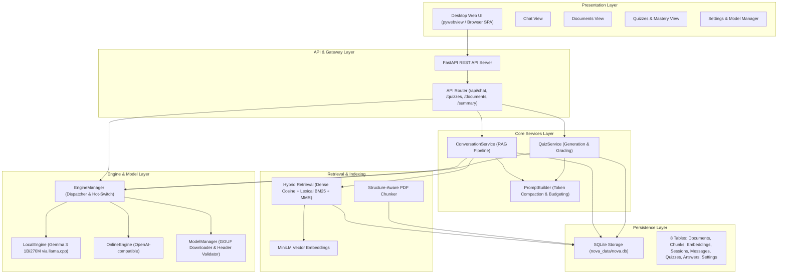

# Nova — Comprehensive Project & Architecture Report

> **Document Version:** 2.0  
> **Project Target:** Offline-First AI Study Companion (Desktop Application)  
> **Repository:** Nova (tarunasam777/Nova)

---

## Executive Summary

**Nova** is an **offline-first, privacy-preserving AI study companion** designed for students and learners who need intelligent educational assistance even in low- or no-connectivity environments. 

Running locally on consumer hardware, Nova ingests course materials (PDFs), indexes them with hybrid semantic and lexical retrieval (RAG), answers student queries with evidence-backed citations, generates interactive quizzes, tracks learner mastery, and persists study history—**entirely on-device without sending sensitive documents to the cloud**.

```
┌────────────────────────────────────────────────────────────────────────────┐
│                                   NOVA                                     │
│   Local PDF Ingestion ──► Hybrid RAG ──► Gemma 3 LLM ──► Quiz & Mastery    │
│              (100% On-Device • Zero Cloud Dependency • SQLite)              │
└────────────────────────────────────────────────────────────────────────────┘
```

---

## 1. What is Nova?

### 1.1 Core Mission & Value Proposition
Students frequently study in environments with unstable internet access (commutes, rural areas, campus dead zones). Cloud-based AI tutors have high latency, ongoing API costs, and privacy vulnerabilities when uploading proprietary academic texts. 

Nova addresses this by providing:
1. **Zero-Cloud Dependency**: Runs on local quantized models (Gemma 3 1B & 270M) via `llama-cpp-python`.
2. **Grounded RAG Tutoring**: Answers questions strictly from uploaded lecture notes/textbooks with exact context matching, preventing hallucinations.
3. **Active Recall & Mastery Tracking**: Automatically creates multiple-choice quizzes from document sections, grades student responses, and tracks long-term study mastery.
4. **Instant Document Summarization**: Condenses extensive readings into structured summaries.
5. **Hybrid Engine Flexibility**: Operates offline by default, while supporting optional cloud OpenAI-compatible endpoints when explicitly toggled.

---

## 2. System Architecture

Nova is organized as a clean, modular multi-layer architecture with strict separation between presentation, application orchestration, AI engines, retrieval, and persistence.



### 2.1 Component Breakdown

#### 1. Presentation Layer (`Nova/frontend/desktop/`)
- **Single Page Application (SPA)**: Text-first, responsive interface built with clean HTML5, CSS3, and modern vanilla JavaScript.
- **Views**:
  - **Chat**: Multi-turn conversation with active document context tags, model selector badges, session dropdown, and code-block copy buttons.
  - **Documents**: Drag-and-drop PDF upload, per-section list, document deletion, and one-click AI Summary trigger. Sections feed the quiz picker so a quiz can be generated from any chapter instead of only the first chunk.
  - **Quizzes**: Quiz generation per document chunk, interactive 4-option quiz cards with instant feedback, option shuffling, and a **Quiz Score Mastery Dashboard** (accuracy %, total correct, mastery progress).
  - **Settings**: Engine selection (Local vs. Online), OpenAI API key input, temperature slider, context size selector (1024–8192), local model switcher, and GGUF installer.
- **Desktop Wrapper**: Native desktop window powered by `pywebview` with fallback `--server` mode for browser access.

#### 2. API Layer (`Nova/backend/api/routes.py`)
- **FastAPI Endpoints**:
  - `POST /api/documents/upload` — Ingests PDF, chunks text, generates embeddings, stores in SQLite.
  - `GET /api/documents/{doc_id}/summary` — Generates a multi-point executive summary.
  - `POST /api/chat` — Executes grounded RAG question answering.
  - `POST /api/quizzes/generate` & `POST /api/quizzes/answer` — Generates and scores quizzes.
  - `GET /api/sessions/{session_id}/quiz-results` — Aggregates mastery stats and historical answers.
  - `GET /api/health`, `GET /api/models/status`, `POST /api/models/download` — Model lifecycle management.
  - `GET /api/settings/{key}` & `PUT /api/settings/{key}` — Runtime configuration updates.

#### 3. Retrieval & Indexing Pipeline (`Nova/backend/retrieval/`)
- **Structure-Aware Chunker (`chunker.py`)**: Cleans headers/footers/page numbers, splits text preserving headings and paragraphs, computes deterministic content hashes.
- **Dense Vector Embedder (`embeddings.py`)**: Uses `all-MiniLM-L6-v2` locally cached embeddings with float32 binary blob storage.
- **Hybrid Search & Diversity (`service.py`)**: Blends dense cosine similarity with lexical keyword matching, applies relevance threshold filtering, and deduplicates evidence using **Maximal Marginal Relevance (MMR)**.

#### 4. Prompt Engineering & Budgeting (`Nova/backend/prompting/builder.py`)
- **Token Budgeting**: Dynamically estimates token counts and compacts chat history, system instructions, and retrieved chunks to strictly fit small context windows (2,048 tokens).
- **Specialized Prompts**: Dedicated prompting strategies for grounded question answering, structured multi-question quiz generation, and executive document summarization.

#### 5. Inference Engines (`Nova/backend/engines/`)
- **`LocalEngine` (`local.py`)**: High-performance CPU/GPU inference via `llama-cpp-python` loading quantized GGUF weights. Includes background thread pre-warming to prevent first-request cold-start delays.
- **`OnlineEngine` (`online.py`)**: OpenAI-compatible client for cloud fallback.
- **`EngineManager` (`manager.py`)**: Hot-swapping between engines and models without server restarts.
- **`ModelManager` (`models/manager.py`)**: Validates GGUF magic headers and manages chunked background downloads.

#### 6. Persistence Layer (`Nova/backend/storage/database.py`)
- **SQLite Database (`nova_data/nova.db`)**: 8 relational tables with foreign key cascades:
  1. `documents`: Metadata for uploaded PDFs.
  2. `chunks`: Extracted text chunks with document positions and hashes.
  3. `embeddings`: Serialized dense vector blobs.
  4. `sessions`: Study conversation sessions.
  5. `messages`: User and assistant chat history.
  6. `quizzes`: Generated quiz records linked to chunks.
  7. `quiz_answers`: Student responses, correctness flags, and timestamps.
  8. `settings`: Key-value application configuration.

---

## 3. Current Implementation Status

### 3.1 Status Summary Table

| Category | Component / Feature | Status | Notes |
|---|---|---|---|
| **Backend Core** | FastAPI App & CORS | ✅ 100% | Robust factory pattern with clean lifecycle |
| **Backend Core** | SQLite Storage (8 Tables + FKs) | ✅ 100% | Full CRUD operations, cascade deletes, schema migrations |
| **Backend Core** | REST API Endpoints | ✅ 100% | Documents, chat, quizzes, summary, sessions, settings |
| **RAG Pipeline** | PDF Text Extraction & Chunker | ✅ 100% | Structure-aware, header/footer cleaning, stable hashes |
| **RAG Pipeline** | MiniLM Embeddings & Binary Storage | ✅ 100% | Local sentence-transformers with fallback; missing vectors are backfilled on the next query |
| **RAG Pipeline** | Hybrid Retrieval + MMR Diversity | ⚠️ Conditional | Dense + lexical filtering and deduplication. Semantic half requires the embedding model, which is *not* bundled — Settings → Semantic Search installs it; without it retrieval is lexical-only and says so |
| **Prompting** | 2048 Context Token Compaction | ✅ 100% | History truncation, budget enforcement |
| **Prompting** | Document AI Summarization | ✅ 100% | Endpoint + PromptBuilder wired |
| **LLM Inference** | Local Gemma 3 GGUF (llama.cpp) | ✅ 100% | Model warm-up thread & header validation |
| **LLM Inference** | Online OpenAI-compatible Engine | ✅ 100% | API key configuration wired in Settings |
| **LLM Inference** | Hot-swapping & Model Manager | ✅ 100% | Gemma 3 1B & 270M GGUF models bundled |
| **Quiz System** | Universal Multi-Question Generation | ✅ 100% | Robust JSON + Markdown/Text parsing fallback; prompt reserves output room so JSON is not truncated |
| **Quiz System** | Chunk/Section Selection | ✅ 100% | Picker over document sections, defaults to the richest section |
| **Quiz System** | Balanced Option Shuffling & Badges | ✅ 100% | Dynamic key mapping & visual answer badges |
| **Quiz System** | Score Mastery Dashboard | ✅ 100% | Live accuracy %, total score, progress metrics |
| **Frontend UI** | 4-Panel Responsive SPA | ✅ 100% | Chat, Documents, Quizzes, Settings |
| **Frontend UI** | Modals & Dialogs | ✅ 100% | Model picker, summary viewer, confirm dialogs |
| **Frontend UI** | State & Document Context Persistence| ✅ 100% | `localStorage` document restoration across reloads |
| **Quality & Tests**| Unit & Integration Test Suite | ✅ 100% | **58/58 tests passing** (see `FIXING_REPORT.md` §5) |
| **UX Polish** | Token Response Streaming (SSE) | ✅ 100% | Real-time token streaming with live DOM rendering & fallback |
| **Packaging** | PyInstaller Single-Binary / Spec | ✅ 100% | `nova.spec`, `build_windows.bat`, `build_desktop.sh` created |
| **CI/CD** | Automated Testing Pipeline | ✅ 100% | `.github/workflows/ci.yml` matrix testing across Python 3.10-3.12 |
| **RAG Extension**| Multi-Document Unified Search | ✅ 100% | Cross-document retrieval & clear doc toggle affordance |
| **Data Integrity** | Chunk Identity, Scoped Reads, WAL Storage | ✅ 100% | Document-scoped chunk IDs, per-document queries, resumable writes |
| **Model Loading** | Real Start-up Pre-load & Thread-safe Load | ✅ 100% | Warm-up loads the GGUF; concurrent first requests share one model |
| **OCR** | Scanned / Image PDF Ingestion | ⏳ Backlog | Optional Tesseract integration for image-only scans |

---

## 4. What Is Left to Reach Full Working Prototype & Production

To transition Nova from its current functional codebase into a polished, production-grade release, the following tasks remain:

```
┌─────────────────────────────────────────────────────────────────────────────┐
│                           ROADMAP STATUS SUMMARY                            │
├───────────────────┬───────────────────────────────┬────────────┬────────────┤
│ Category          │ Task                          │ Complexity │ Status     │
├───────────────────┼───────────────────────────────┼────────────┼────────────┤
│ 🚀 Core UX        │ Token Response Streaming (SSE)│ Medium     │ ✅ Done    │
│ 📦 Distribution   │ PyInstaller Desktop Bundler   │ Medium     │ ✅ Done    │
│ 🔍 RAG            │ Multi-Document Cross-Search   │ Low        │ ✅ Done    │
│ ⚙️ Pipeline       │ CI/CD Pipeline (GitHub Actions│ Low        │ ✅ Done    │
│ 🎯 Stability      │ Reliable 0.7 Temp Config Fix  │ Low        │ ✅ Done    │
│ 🟢 Enhancement    │ Tesseract OCR for Scanned PDFs│ Medium     │ ⏳ Backlog │
└───────────────────┴───────────────────────────────┴────────────┴────────────┘
```

### 4.1 Detailed Breakdown of Remaining Work

#### 1. 🔴 Token Response Streaming (SSE / `StreamingResponse`)
- **Current State**: Responses return as a single batch after the full generation finishes (10–25s on CPU).
- **Required Implementation**:
  - Update `LocalEngine.generate()` to accept `stream=True` yielding tokens.
  - Implement a `POST /api/chat/stream` endpoint returning `StreamingResponse(..., media_type="text/event-stream")`.
  - Update `app.js` using `fetch` with `ReadableStream` reader to render tokens in real time.
- **Impact**: Dramatic improvement in perceived responsiveness and user experience.

#### 2. 🟡 PyInstaller Desktop Executable Packaging
- **Current State**: Runs via `python main.py` in a Python virtual environment.
- **Required Implementation**:
  - Create `nova.spec` defining entry points, data asset bundling (`frontend/`, `config.json`), and hidden imports (`pywebview`, `llama_cpp`, `sentence_transformers`).
  - Add build scripts (`build_windows.bat`, `build_mac.sh`).
- **Impact**: Enables one-click installation and execution for end-users without requiring a Python environment.

#### 3. 🟡 Multi-Document Unified Querying
- **Current State**: Retrieval filters by the single `activeDocumentId` selected in the UI.
- **Required Implementation**:
  - Allow selecting "All Documents" or multi-selecting documents in the chat header.
  - Pass `document_ids: list[str] = None` to `RetrievalService` (which already natively supports cross-document querying).
- **Impact**: Allows students to query across an entire semester's course materials simultaneously.

#### 4. 🟢 Scanned PDF OCR Fallback
- **Current State**: PDFs with image-only pages or scanned text fail text extraction.
- **Required Implementation**:
  - Detect empty text extracts and trigger optional `pytesseract` / OCR extraction.
- **Impact**: Broader compatibility with older course handouts and scanned textbook pages.

#### 5. 🟢 Continuous Integration (CI/CD)
- **Current State**: Tests run locally via `pytest`.
- **Required Implementation**:
  - Add `.github/workflows/ci.yml` running unit tests, syntax checks (`node --check`, `python -m compileall`), and cross-platform matrix tests.

---

## 5. File & Component Reference Index

```
Nova/
├── main.py                                  # Application entry point (pywebview & CLI server)
├── config.json                              # Local runtime configuration (model paths, settings)
├── requirements.txt                         # Pinned Python package dependencies
├── pyproject.toml                           # Build tool and pytest configuration
├── models/                                  # Bundled local GGUF models
│   ├── gemma-3-1b-it-Q4_K_M.gguf           # Gemma 3 1B quantized weights (~769 MB)
│   └── gemma-3-270m-it-Q4_K_M.gguf          # Gemma 3 270M lightweight weights (~241 MB)
├── nova_data/                               # Persistent runtime SQLite database directory
│   └── nova.db                              # Relational database file
└── Nova/
    ├── backend/
    │   ├── main.py                          # FastAPI application factory & static file mounting
    │   ├── config.py                        # Settings dataclass & environment variable overrides
    │   ├── api/routes.py                    # REST API route handlers
    │   ├── engines/
    │   │   ├── base.py                      # Abstract Engine base class
    │   │   ├── local.py                     # llama-cpp-python engine with warm-up thread
    │   │   ├── online.py                    # OpenAI-compatible cloud client
    │   │   └── manager.py                   # Engine dispatcher and dynamic switcher
    │   ├── models/manager.py                # Model downloader & GGUF header validation
    │   ├── retrieval/
    │   │   ├── chunker.py                   # PDF text extraction, cleaning & chunking
    │   │   ├── embeddings.py                # MiniLM local sentence embedder
    │   │   └── service.py                   # Hybrid dense + lexical search & MMR diversity
    │   ├── prompting/builder.py             # Token budgeting, compaction & prompt templates
    │   ├── services/
    │   │   ├── conversation.py              # End-to-end RAG chat orchestration
    │   │   └── quiz.py                      # Quiz generation, universal parser & mastery grading
    │   └── storage/database.py              # SQLite storage layer (8 tables + migrations)
    ├── frontend/desktop/
    │   ├── index.html                       # Desktop SPA HTML layout (4 views + modals)
    │   └── static/
    │       ├── app.js                       # Frontend state, API integration & DOM management
    │       └── style.css                    # Dark modern design system & animations
    └── tests/                               # Comprehensive automated test suite
        ├── test_chunker.py                  # PDF cleaning, section/heading detection, chunk identity
        ├── test_retrieval.py                # Hybrid search, scoped reads, vector scoring & backfill
        ├── test_storage.py                  # SQLite schema, CRUD, previews, concurrency
        ├── test_api.py                      # REST endpoints, document/summary/quiz/settings API
        ├── test_prompt_budget.py            # Chat/quiz/summary token budgeting
        ├── test_config.py                   # Runtime path resolution and persistence
        └── test_engine.py                   # Local-engine warm-up, locking, token budgeting
```

---

## 6. Conclusion

Nova's core backend pipeline, RAG architecture, on-device Gemma 3 inference, quiz engine with mastery tracking, document summarization, and desktop UI are implemented and verified against a live server with a real GGUF model (see `FIXING_REPORT.md` §5 for the end-to-end evidence).

The application is a functional, offline-capable study assistant with **58 passing tests**. Token streaming and PyInstaller packaging are complete.

---

## 7. Post-audit status (current)

The August feature audit in sections 3–4 overstated completeness: several defects sat on paths that had no test coverage (a document summary endpoint returning HTTP 500, chunk IDs that collided between documents, a model pre-load that never loaded, silent fallback from hybrid to keyword-only retrieval, quiz JSON truncated by an unbudgeted prompt). Every one of them is now reproduced, fixed and regression-tested in **`FIXING_REPORT.md`**, which is the authoritative status for the repaired areas:

| Area | Result |
|---|---|
| Chunking | Document-scoped chunk IDs (no cross-document collapse), heading text preserved, sections like `CHAPTER 2 THE WATER CYCLE` detected, no text loss |
| Loading/data | Relative paths anchored to the app root, SQLite WAL + busy timeout, per-document chunk/vector reads, SQL-side previews |
| Retrieval | Scoped query 16.6 ms → 0.9 ms; full library 547 ms → 147 ms; numpy vector scoring with a stdlib fallback; on-demand vector backfill |
| Model | Start-up warm-up actually loads the GGUF; single load under concurrency; accurate token budgeting (prompt was over-counted ~2×); opt-in thread override |
| Prompting | Chat evidence moved into the final user turn; quiz/summary budgets reserve output room |
| API | Summary endpoint fixed; blocking handlers off the event loop; CORS restricted to local origins; lifespan startup |
| Frontend | Section picker for quizzes, SSE error propagation, per-frame render throttle, embedding install UI |
| Tests | 24 → 58, covering every regression above |
